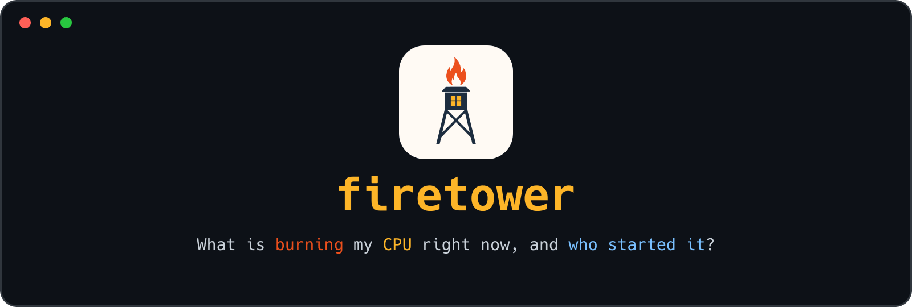
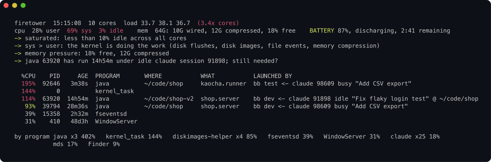

<!-- jump_to_middle -->
<!-- alignment: center -->



<!-- end_slide -->

Rationale
===

**firetower**: a fire lookout's tower, built to see where smoke rises. The Greeks chained such towers to pass news by fire.

`top` and Activity Monitor rank processes by CPU. They do not say where a process runs, who started it, or whether its time is its own work or the kernel working for it. On a laptop full of coding agents those are the questions: sessions start dev servers and test runs, then move on, and what they leave behind keeps burning.

The alternative is piecing it together by hand with `ps` and `lsof`, or asking an agent to do it and waiting while it does.

<!-- end_slide -->

What I wanted
===

* **One screen, in a few seconds, with no setup.** A check you run without thinking about it.
* **The cause, not just the culprit.** Where it runs, what it runs, who launched it, and what the numbers add up to.
* **Nothing secret on screen.** This output gets pasted into chats and screenshots, and command lines carry tokens.
* **Names you can trust.** From the kernel, which a process cannot rename.
* **One small binary.** Nothing to install, nothing to keep running.

<!-- end_slide -->

The question
===

The fans are loud. Load is **38 on 10 cores**, on battery.

First guess: the 25 coding-agent sessions. Together they used **18% of one core**.

The cause: a test run and two dev servers that agents had started, one of them left behind 15 hours earlier by a session now idle. Their databases flushed to RAM disks, and the kernel did the heavy lifting.

`firetower` puts that evidence on one screen in a few seconds.

<!-- end_slide -->

Install
===

**macOS only.** Building needs Go 1.22 or later and the Xcode command line tools; the result is one 2 MB binary that needs nothing.

```bash
git clone https://github.com/multiplyco/firetower ~/code/firetower
cd ~/code/firetower
mkdir -p ~/.local/bin ~/.local/share/man/man1
go build -trimpath -ldflags "-s -w" -o ~/.local/bin/firetower .
ln -sf "$PWD/firetower.1" ~/.local/share/man/man1/
```

`~/.local/bin` must be on your PATH; `man firetower` then finds the page through it, unless MANPATH is set.

<!-- end_slide -->

One screen
===



Row three is the leftover: a dev server that a Claude session started 15 hours ago. That session is now idle.

<!-- end_slide -->

How to read it
===

| You see | It tells you |
|---|---|
| `load ... (3.4x cores)` | how much more work is waiting than the cores can run |
| `user` vs `sys` | programs computing, or the kernel working for them |
| `mem` | wired, compressed and free memory, by the kernel's own measure |
| `BATTERY` or `AC` | power source, charge, time left |
| `->` | what the numbers add up to |
| `WHERE` | the working directory: which repo or worktree |
| `WHAT` | main class, script, subcommand, or a Claude session's title |
| `LAUNCHED BY` | the parent, then the agent session above it: state, title, directory |
| `by program`, `agents` | totals, so many small processes add up |

`man firetower` covers every field and threshold.

<!-- end_slide -->

When sys beats user
===

High `sys` means the kernel is doing the work on someone's behalf:

* disk flushes (`fsync` storms from databases, even idle ones)
* disk images and RAM disks (`diskimages-helper`)
* file watching (`fseventsd`) and indexing (`mds`)
* memory compression and swap

Those daemons near the top are symptoms. Fix the program feeding them, not the daemon.

<!-- end_slide -->

Command lines stay off screen
===

Command lines carry tokens and passwords, and a process can rewrite its own. Tools that print them leak secrets into terminals, screenshots and agent transcripts.

`firetower` shows at most one word from a command line: a dotted script, class or module name, or a short lowercase subcommand like `test`. Never inline code (`bash -c`, `node -e`). Program names come from the kernel.

It reads `top`, `ps`, `lsof`, `pmset`, Claude Code's session registry and the last megabyte of its transcripts. It writes nothing and makes no network connections.

<!-- end_slide -->

Flags
===

```bash
firetower              # the 12 busiest, sampled over 2s
firetower 5            # just the top five (same as -n 5)
firetower -s 10        # a longer, smoother sample
NO_COLOR=1 firetower   # plain text
```

A spinner runs while it samples. Below 120 columns, each row's context moves to a line of its own.

<!-- end_slide -->

Built with Go
===

One file of Go, standard library only. It builds to a single 2 MB binary that needs nothing installed, and to a universal one for Apple silicon and Intel with `lipo`.

Program names and paths come from the kernel, so a process cannot disguise itself.

<!-- end_slide -->

License
===

Eclipse Public License 2.0. Copyright (c) 2026 Multiply. See [LICENSE](LICENSE).
